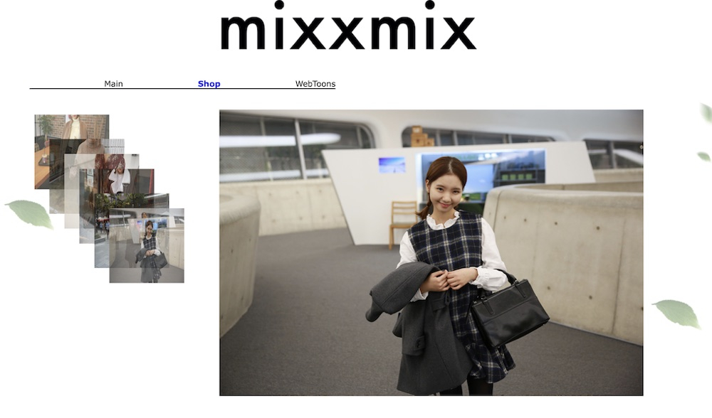

# Shopping Shop

[English](README.md)

의류 쇼핑몰을 주제로 한 원페이지 웹사이트다. 위쪽에 고정된 메뉴로 Main, Shop, WebToons 세 섹션을 오간다. 메인 배너는 자동으로 넘어가고 상품 갤러리는 스크롤하면 펼쳐지며 배경 장식은 스크롤에 따라 다른 속도로 움직인다. HTML, CSS, jQuery 로 3명이 함께 만든 학교 과제다.

<p>
  
</p>


## 사용 방법

Releases에서 받아 압축을 풀고 `index.html` 을 웹 브라우저로 열면 된다. 화면 폭 1280픽셀에 맞춘 고정 폭 레이아웃이다.

| 섹션 | 내용 |
|---|---|
| Main | 세 장짜리 메인 배너. 좌우 버튼이나 아래 썸네일로 넘기고 4초마다 저절로 넘어간다 |
| Shop | 상품 썸네일 여섯 장과 큰 상품 사진. 썸네일에 마우스를 올리면 앞으로 나오고 누르면 큰 사진이 그 상품으로 바뀐다 |
| WebToons | 포털, 웹툰, 학교 사이트로 가는 2뎁스 메뉴와 네 장짜리 슬라이드 배너를 담은 페이지 |


## 구현 원리

**메뉴와 스크롤 위치를 서로 맞춘다.** 메뉴를 누르면 같은 순번의 섹션 위치로 `scrollTop` 을 애니메이션해 부드럽게 내려간다. 반대로 스크롤할 때마다 섹션을 차례로 보며 위쪽이 화면 맨 위를 지난 섹션을 찾아, 그 순번의 메뉴에 `on` 클래스를 붙여 강조한다.

**메인 배너는 배경 그림을 바꿔 넘긴다.** 넘길 때마다 배너를 0.5초 동안 `fadeOut` 하고 `background-image` 를 다음 그림으로 바꾼 뒤 다시 `fadeIn` 한다. 현재 그림의 썸네일만 불투명도 1 로, 나머지는 0.5 로 둔다. 4초 타이머는 손으로 넘길 때마다 다시 시작한다.

**상품 갤러리는 섹션에 들어설 때 만든다.** Shop 섹션이 화면 맨 위에 걸리면 큰 사진 한 장과 썸네일 여섯 장을 그 자리에서 추가한다. 썸네일은 순번마다 30픽셀씩 비켜난 자리로, 뒤 순번일수록 0.2초씩 더 길게 움직여 비스듬히 겹쳐 펼쳐진다. 큰 사진의 폭은 창 폭에서 380픽셀을 뺀 값이고 850픽셀을 넘지 않는다. 섹션을 벗어나면 모두 지우고 창 크기가 바뀌면 다시 만든다.

**배경 장식은 순번마다 다른 비율로 움직인다.** 스크롤할 때마다 장식 그림 여섯 개의 `top` 을 다시 정한다. 현재 섹션 안에서 스크롤한 거리에 2를 곱하고 순번으로 나눈 값을 더하므로 뒤 순번의 그림일수록 덜 움직여 깊이감이 생긴다.

```js
parallax.each(function (i){
	var target = $(this);
	target.css({
		top: scroll_top + 100*(i+1) + (sub*2/(i+1))
	});
});
```

**WebToons 섹션은 별도 페이지를 `iframe` 으로 띄운다.** `webpagemaking/webpagemake.html` 의 2뎁스 메뉴는 위 메뉴에 마우스를 올리면 메뉴 영역의 높이를 하위 메뉴까지 늘려 펼친다. 슬라이드 배너는 현재 그림을 왼쪽 밖으로, 다음 그림을 오른쪽 밖에서 제자리로 동시에 움직여 넘기고 아래 점 버튼에 마우스를 올리면 그 그림으로 간다. 가만히 두면 저절로 넘어간다.


## 파일

| 경로 | 내용 |
|---|---|
| `source/index.html`, `source/index.css` | 원페이지 본문과 스타일 |
| `source/scroll_menu.js` | 메뉴 클릭 스크롤과 현재 섹션 강조 |
| `source/gallery.js` | 메인 배너 |
| `source/responsive.js` | 상품 갤러리 |
| `source/parallax.js` | 배경 장식 |
| `source/image/` | 배너, 상품, 장식 그림 |
| `source/webpagemaking/` | WebToons 섹션의 2뎁스 메뉴와 슬라이드 배너 페이지 |
| `docs/screenshots/` | 스크린샷 |
| Releases | 사이트 전체 |


## 크레딧

- `jquery-1.11.1.min.js`, `webpagemaking/js/jquery-1.9.1.min.js`, `webpagemaking/js/jquery.min.map`: jQuery Foundation 의 jQuery. MIT 라이선스
- `jquery.easing.1.3.js`, `webpagemaking/js/jquery.easing.1.3.min.js`: George McGinley Smith 의 jQuery Easing 1.3. BSD 라이선스


## 라이선스

zlib 라이선스다. 자세한 내용은 [LICENSE](LICENSE) 에 있다. 함께 들어 있는 것 중 다른 사람이 만든 라이브러리는 각자의 라이선스를 따른다. 사이트에 쓰인 상품 사진과 그림은 각 저작권자의 것이다.
